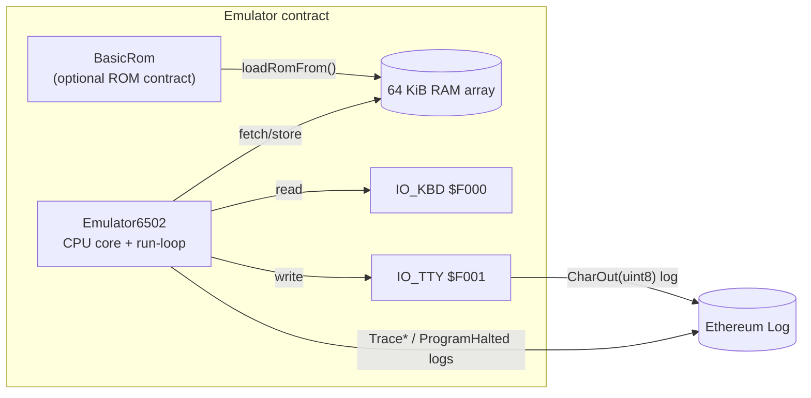

# 6502-on-EVM Emulator

A MOS 6502 CPU written in pure Solidity, with a minimal keyboard and character-terminal I/O. The aim is to run unmodified 6502 machine code, such as EhBASIC 2.22, inside the EVM.

## Status: working CPU core, BASIC does not boot yet

- **Works:** the CPU core, memory, and terminal output. A 27-byte "HELLO WORLD!" program runs and its output is checked by `test/MiniRomHello.t.sol`. The repo also has unit tests for opcodes, addressing modes, arithmetic, branches, stack/JSR, interrupts, and I/O (`test/`).
- **Not working:** EhBASIC. The ROM loads and reaches the soft-vector table, but the `CHRIN` stub and some opcodes are still missing. The committed `logs.txt` shows `test/HelloWorld.t.sol` (the BASIC debugging harness) reverting with `OpcodeNotImplemented`. That log may predate later commits, and I did not re-run it.

## Run it

Requires [Foundry](https://book.getfoundry.sh/).

```bash
forge build
forge test -vvv                                      # everything
forge test --match-contract MiniRomHelloTest -vv     # the fast HELLO WORLD demo
```

## Architecture



### Memory map (default)

| Range           | Purpose                                   |
|-----------------|-------------------------------------------|
| $0000 – $07FF   | Zero‑page & stack                         |
| $0800 – $9FFF   | Free RAM for user code / tests            |
| $A000 – $DFFF   | 16 KiB BASIC ROM (EhBASIC)                |
| $E000 – $EFFF   | Reserved                                  |
| $F000 – $F0FF   | Memory‑mapped I/O (KBD & TTY)             |
| $F100 – $F7FF   | Scratch for test stubs                    |
| $F800 – $FFFF   | Vectors & high ROM                        |

## Repo map

| Path | Description |
|------|-------------|
| `src/Emulator6502.sol` | CPU model, 64 KiB RAM, run loop, opcode dispatcher, soft vectors, and I/O. Emits `CharOut`, `TracePC`, `TraceJSR`, and `ProgramHalted`. |
| `src/BasicRom.sol` | A contract whose runtime bytecode is the EhBASIC ROM, loaded into RAM with `loadRomFrom(address, baseAddr)`. Generated by `scripts/build_basic_rom.py`. |
| `src/OpcodeTable.sol` | Opcode table. |
| `test/` | Foundry tests: opcode and addressing-mode unit tests, plus integration tests (BASIC boot, mini-ROM demos). |
| `script/LoadRom.s.sol` | Foundry script for deploying the ROM cartridge. |
| `rom/` | EhBASIC image (`ehbasic.rom`) and hex dumps. |
| `instructions.md`, `instructions/implementation.md` | 6502 reference notes used as context when implementing the core. |

## Mini-ROM "HELLO WORLD!" demo

`test/MiniRomHello.t.sol` injects 27 bytes of machine‑code at $9000:

```
$9000  A2 00        LDX #$00
$9002  BD 0D 90     LDA $900D,X
$9005  F0 13        BEQ $901A
$9007  8D 01 F0     STA $F001      ; write char → event
$900A  E8           INX
$900B  D0 F5        BNE $9002
$900D  "HELLO WORLD!" 00
$901A  00           BRK            ; vector via IRQ
```

The test captures `CharOut` events and asserts the exact string appears.  This proves the CPU core, memory system, and terminal I/O all function even without BASIC.

## Building and loading ROMs

### 1  Author or obtain 6502 machine‑code

You can write 6502 assembly using any cross‑assembler ([`ca65`](https://github.com/cc65/cc65), [`vasm`](http://www.compilers.de/vasm.html), etc.) or carve out raw bytes in a hex‑editor.

```asm
        ; hello.asm – assemble with ca65 & ld65
        * = $A000         ; origin inside RAM
        LDX #0            ; X = 0
LOOP    LDA MSG,X         ; load byte
        BEQ DONE         ; 0‑terminator ?
        STA $F001         ; output char
        INX
        BNE LOOP
DONE    BRK
MSG     .byte "HELLO",0
```

### 2  Package as a Solidity ROM contract *(optional)*

For larger programs you can embed the raw bytes in a contract so tests (or front‑ends) can deploy and `loadRomFrom()` it at runtime.  See `scripts/build_basic_rom.py` which generates `src/BasicRom.sol` from a 16 KiB binary.

### 3  Load the ROM into the emulator

```solidity
Emulator6502 emu = new Emulator6502();

// (A) Using an on‑chain ROM contract
BasicRom rom = new BasicRom();
emu.loadRomFrom(address(rom), 0xA000); // copy into RAM at $A000

// (B) Manual poke for small snippets
bytes memory code = hex"a9008d01f000"; // LDA #$00 ; STA $F001 ; BRK
for (uint16 i = 0; i < code.length; i++) {
    emu.poke8(0x8000 + i, uint8(code[i]));
}

// Set RESET vector so CPU starts executing at our code
emu.poke8(0xFFFC, 0x00);
emu.poke8(0xFFFD, 0x80); // -> $8000

emu.boot();
emu.run(10);
```

### 4  Observe output

Catch `CharOut(uint8)` logs in tests or front‑ends to reconstruct the terminal stream.  Use `TracePC`/`TraceJSR` for debugging and `ProgramHalted` for graceful termination.

## Development workflow

1. Write or modify tests in `test/`. Unit tests should prefer synthetic ROM snippets; integration tests may load `BasicRom`.
2. Implement opcodes in `Emulator6502.sol`, with helper methods next to their caller.
3. Run `forge test -vvv` often; each commit should add passing tests only.
4. Use `emit TracePC` and `pcTraceBuf` for deep ROM debugging. `test/HelloWorld.t.sol` is the harness that traces PCs and JSRs.

## Where can you deploy it?

Running 64 KiB of RAM inside the EVM is storage-heavy. The table below is the author's estimate of compatibility and cost by chain. It is not backed by measurements in this repo.

| Network / stack | 0.8.20 compiler | 24 kB code‑size cap | Gas price / storage cost | Verdict for this 6502 core |
|-----------------|-----------------|----------------------|---------------------------|----------------------------|
| **MegaETH** | ✔ | 24 kB (same as L1) | Ultra‑cheap, tuned for heavy on‑chain compute | **YES – ideal target** |
| **Monad**  | ✔  | 24 kB | Very high throughput, low gas | Should work once live; good fit |
| **Arbitrum Orbit** (custom Nitro chains) | ✔ | 24 kB per contract | Chain operator can set near‑zero gas & high block gas | **YES – deploy on your own Orbit** |
| Arbitrum One / Nova | ✔ | 24 kB | Cheaper than L1 but `SSTORE` still pricey | Works technically, but each `step()` costs 0.3–0.6 M gas |
| Ethereum mainnet / Sepolia / Holesky | ✔ | 24 kB | Very high gas for 64 kB storage writes | Deploys, but running even a few hundred instructions exceeds block gas – impractical |
| OP‑Stack chains (Base, Mode, etc.) | ✔ | 24 kB | Similar to Arbitrum One | Technically OK, pricey in practice |
| zk‑rollups (Scroll, Linea, zkSync Era) | ✔ | 24 kB | Proof cost amplifies storage writes | Works, but economics worse than optimistic L2s |

## Why a 6502?

The MOS 6502 is the 8-bit processor used in 1980s home computers such as the Commodore 64 and Apple II. This project emulates one in Solidity so it runs deterministically in the EVM and produces events instead of pixels. You can load 6502 machine code, let it read "keyboard" bytes, and collect the characters it prints from `CharOut` logs.

Built by Dennison Bertram & ChatGPT o3.
