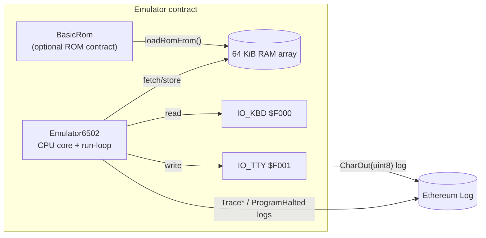

# 6502-on-EVM Emulator

A MOS 6502 CPU written in pure Solidity (Foundry project), with a keyboard and character-terminal I/O, plus a Next.js front end that drives it on a local Anvil chain.

## Status: the CPU core and EhBASIC work in tests; the Klaus functional test fails

Results from `forge test` (forge 1.7.1) on this branch: 26 suites, 78 passed, 2 failed, 1 skipped.

- **Works:** opcode, addressing-mode, arithmetic, BCD, branch, stack/JSR, interrupt, I/O, HLT and run-loop unit tests all pass. The 27-byte "HELLO WORLD!" mini-ROM test passes (`test/MiniRomHello.t.sol`).
- **EhBASIC 2.22 boots and runs a program in a test,** but only with a raised gas limit. `forge test` with default settings fails `test/HelloWorld.t.sol` with an EVM revert (it runs out of gas). With the command below it passes, prints the EhBASIC banner, and `10 PRINT "HELLO"` / `RUN` prints `HELLO`. The test patches the EhBASIC character input/output vectors to small stubs that use the emulator's I/O addresses.
- **Does not work:** the Klaus Dormann 6502 functional test (`test/KlausFunctional.t.sol`). `test_KlausFunctional_RunsToCompletion` fails with `Trapped at $364E` (the success address is $3469). The other Klaus test, which only checks the start state, passes.
- **Placeholder:** `test/BasicPrompt.t.sol` is skipped on purpose.
- **Build note:** `forge build` compiles the code but exits with status 1, because forge's lint step (solar) reports "recursion limit reached" at `src/Emulator6502.sol:1340`. `forge test` is not affected.

An earlier version of this README said EhBASIC does not boot. That came from an old committed `logs.txt` (a `test_HelloWorld` run that reverted with `OpcodeNotImplemented`) and is out of date.

## Run it

Requires [Foundry](https://book.getfoundry.sh/). The forge-std library is already in `lib/`.

```bash
forge test                                                   # all tests: 78 pass, 2 fail, 1 skipped
forge test --match-contract MiniRomHelloTest -vv             # HELLO WORLD mini-ROM (passes)
forge test --match-test test_HelloWorld -vv --gas-limit 500000000000   # EhBASIC boot + PRINT "HELLO" (passes, about 11 s here)
forge test --match-contract KlausFunctionalTest -vv          # Klaus functional test (1 pass, 1 fail)
```

### Front end (terminal and debug pages)

`frontend/` is a Next.js app (viem) with a terminal page at `/terminal` and a debug dashboard at `/debug` (registers, memory, disassembly, controls). It talks to an emulator contract on a local Anvil node at `http://127.0.0.1:8545` using the default Anvil test key. Nothing is deployed anywhere else.

```bash
cd frontend && npm install
npm run demo   # starts anvil, deploys the ROM at $C000, runs EhBASIC init (see package.json)
npm run dev    # serves http://localhost:3456
```

What I observed: `npm run dev` starts and `/terminal` and `/debug` return HTTP 200. Separately, on a local Anvil node (`anvil --gas-limit 100000000000`), `BASE_ADDR=0xC000 forge script script/LoadRom.s.sol ...` and `EMULATOR=<address> forge script script/RunEhBASICInit.s.sol ...` (the same commands `npm run demo` runs, with the same flags) completed, and the emulator's `CharOut` logs spelled out the EhBASIC banner up to "Enhanced BASIC 2.22". I did not open the pages in a browser or type into the terminal, so the page-level behaviour is not verified. `npm run demo` itself was not run: it hard-codes the emulator address `0xe7f1...0512` (which matched what the script deployed on a fresh Anvil node) and it first stops any running anvil process by name.  `frontend/E2E-TEST-REPORT.md` is the author's own report from 2025-12-25 and says interactive testing still needed manual verification.

## Repo map

| Path | Description |
|------|-------------|
| `src/Emulator6502.sol` | CPU model, 64 KiB RAM, run loop, opcode dispatcher, soft vectors, I/O. Emits `CharOut`, `TracePC`, `TraceJSR`, `ProgramHalted`. Opcode `$02` is used as `HLT`. |
| `src/BasicRom.sol` | A contract whose runtime bytecode is the EhBASIC ROM; copied into RAM with `loadRomFrom(address, baseAddr)`. Generated by `scripts/build_basic_rom.py`. |
| `src/EhBASICInit.sol` | Helper that performs the EhBASIC start-up sequence in one transaction. |
| `src/OpcodeTable.sol` | Opcode table. |
| `test/` | Foundry tests: unit tests per opcode group, `MiniRomHello`, `HelloWorld` (EhBASIC), `KlausFunctional`, `HaltTest`, `BcdTest`. `test/fixtures/klaus_functional.bin` is the Klaus test binary. |
| `script/` | `LoadRom.s.sol`, `InitEhBASIC.s.sol`, `RunEhBASICInit.s.sol`: deploy and initialise on a local node. |
| `frontend/` | Next.js terminal and debug UI. |
| `rom/` | EhBASIC image (`ehbasic.rom`) and hex dumps. |
| `instructions.md`, `instructions/` | 6502 reference notes used while implementing the core. |
| `logs.txt`, `repomix-output.txt`, `broadcast/`, `.playwright-mcp/` | Leftover output from earlier sessions (an old failing test log, a repo dump, a deployment record, screenshots). Not documentation. |

## Architecture



Memory addresses used in the code and tests: keyboard input `$F000`, terminal output `$F001`, CPU vectors `$FFFA`-`$FFFF`. `HelloWorld` and the scripts load the 16 KiB EhBASIC ROM at `$C000`. The mini-ROM test places its code at `$9000`.

## Mini-ROM "HELLO WORLD!" test

`test/MiniRomHello.t.sol` puts 27 bytes of machine code at `$9000`, runs it, collects `CharOut` events, and checks that the text is "HELLO WORLD!":

```
$9000  A2 00        LDX #$00
$9002  BD 0D 90     LDA $900D,X
$9005  F0 13        BEQ $901A
$9007  8D 01 F0     STA $F001      ; write char -> event
$900A  E8           INX
$900B  D0 F5        BNE $9002
$900D  "HELLO WORLD!" 00
$901A  00           BRK            ; vector via IRQ
```

## Using the emulator from Solidity

```solidity
Emulator6502 emu = new Emulator6502();

// (A) Load an on-chain ROM contract
BasicRom rom = new BasicRom();
emu.loadRomFrom(address(rom), 0xC000);

// (B) Or poke a small program in by hand
bytes memory code = hex"a9008d01f000"; // LDA #$00 ; STA $F001 ; BRK
for (uint16 i = 0; i < code.length; i++) {
    emu.poke8(0x8000 + i, uint8(code[i]));
}
emu.poke8(0xFFFC, 0x00);
emu.poke8(0xFFFD, 0x80); // reset vector -> $8000

emu.boot();
emu.run(10);
```

Read `CharOut(uint8)` logs to reconstruct terminal output. `TracePC` and `TraceJSR` help with debugging; `ProgramHalted` is emitted on halt.

## Gas figures

These come from my own `forge test` run (forge 1.7.1) and are the gas that forge reports for the test function, which does not include the cost of `setUp()` (where the emulator is deployed and the ROM loaded):

- `MiniRomHelloTest.test_miniRomPrintsHelloWorld`: 78,713,890 gas.
- `HelloWorldTest.test_HelloWorld` (EhBASIC boot, 1,000,000 emulated steps): 9,167,382,272 gas.

Running a 64 KiB RAM image in EVM storage is expensive, so a real chain would need a very high block gas limit. The earlier README contained a per-chain deployment table; it was an estimate with no measurements behind it and has been removed.

## Why a 6502?

The MOS 6502 is the 8-bit processor used in 1980s home computers such as the Commodore 64 and Apple II. This project runs one deterministically in the EVM and reports its output as events instead of pixels.

Built by Dennison Bertram & ChatGPT o3, with later work (HLT, Klaus harness, front end) added in December 2025.
